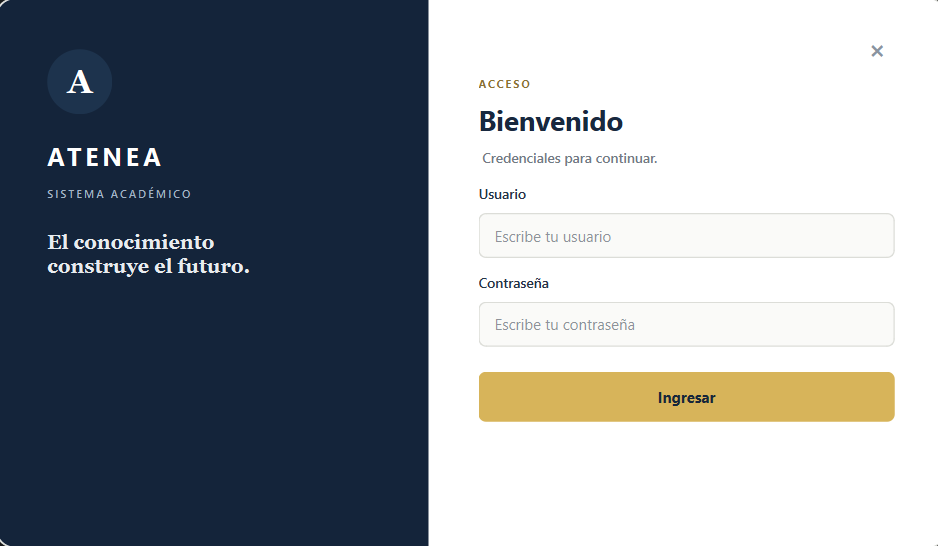
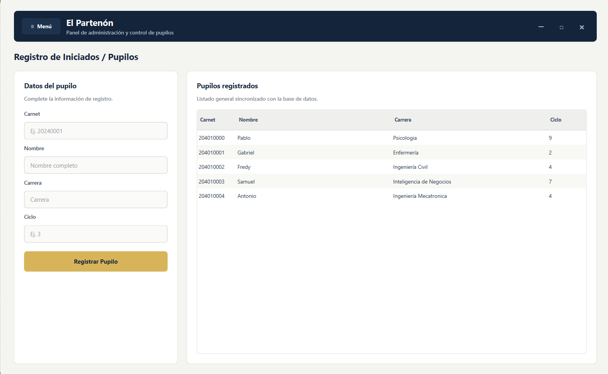
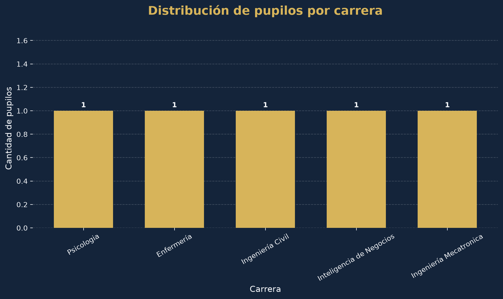
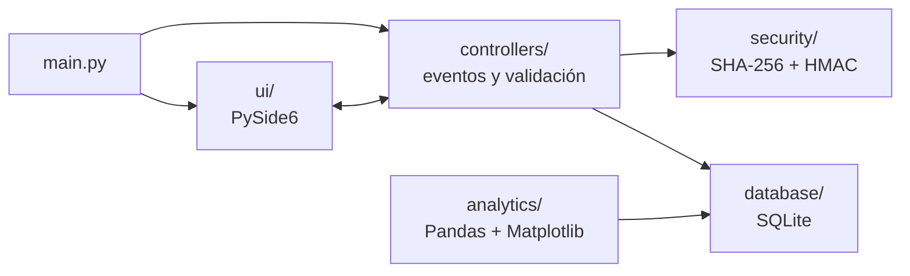

# Sistema Atenea 🏛️

<div align="center">

**Sistema Académico y de Gestión de Tutorías**  
*«El conocimiento construye el futuro»*

[](https://github.com/)
[](https://www.python.org/)
[](https://doc.qt.io/qtforpython/)
[](https://www.sqlite.org/)

</div>

---

## 📌 Descripción

**Sistema Atenea** es una aplicación de escritorio modular para registrar, administrar y consultar a los **pupilos** (estudiantes) atendidos en un entorno de tutorías académicas.

Este **Prototipo 1** (Laboratorio 1, entrega: 15 de noviembre de 2026) demuestra la base técnica del sistema: una arquitectura por capas desarrollada en equipo, persistencia local en SQLite, acceso protegido con hashes SHA-256, una interfaz moderna sin marcos nativos y un módulo de estadísticas con Pandas y Matplotlib.

---

## ✨ Funcionalidades del Prototipo 1

| Funcionalidad | Estado |
| :--- | :---: |
| Inicio de sesión con contraseñas protegidas (SHA-256 + `hmac.compare_digest`) | ✅ |
| Mensajes de error y confirmación en pantalla; acceso con la tecla Enter | ✅ |
| Registro de pupilos (carnet, nombre, carrera y ciclo) con validación de datos | ✅ |
| Listado de pupilos sincronizado con la base de datos SQLite | ✅ |
| Estadísticas de pupilos por carrera o por ciclo (gráfico de barras) | ✅ |
| Gestión de tutores y sesiones de tutoría | 🔜 Prototipo 2 |
| Edición y eliminación de pupilos | 🔜 Prototipo 2 |
| Base de datos compartida y usuarios por integrante (MySQL) | 🔜 Prototipo 2 |

---

## 🖼️ Vista previa

<div align="center">

| Inicio de sesión | El Partenón (panel principal) | Estadísticas |
| :---: | :---: | :---: |
|  |  |  |

</div>

---

## 🧱 Arquitectura

El sistema separa responsabilidades en capas independientes. La interfaz nunca toca la base de datos: todo pasa por los controladores.



```text
sistema_atenea/
├── main.py                     # Punto de entrada y orquestador del sistema
├── requirements.txt            # Dependencias del proyecto
├── README.md                   # Esta página
├── sistema_atenea.db           # Base de datos SQLite (se genera al ejecutar)
│
├── database/                   # CAPA DE DATOS
│   ├── conexion.py             # Conexión y creación de tablas
│   └── crud_pupilos.py         # Inserción y consulta de pupilos
│
├── ui/                         # CAPA DE INTERFAZ
│   ├── ventana_login.py        # Pantalla de acceso
│   └── ventana_partenon.py     # Panel principal (El Partenón)
│
├── controllers/                # CAPA DE CONTROLADORES
│   ├── controlador_login.py    # Eventos y autenticación del acceso
│   ├── controlador_main.py     # Puente entre la tabla visual y SQLite
│   └── validaciones.py         # Validación de los datos del formulario
│
├── security/                   # CAPA DE SEGURIDAD
│   ├── auth_manager.py         # Hashing SHA-256 y verificación de credenciales
│   └── documentacion.txt       # Manual técnico del módulo
│
├── analytics/                  # CAPA ANALÍTICA
│   └── graficos_progreso.py    # Estadísticas con Pandas y Matplotlib
│
└── docs/                       # DOCUMENTACIÓN
    ├── informe_laboratorio1.md # Informe técnico del prototipo
    └── manual_usuario.md       # Guía de uso para el usuario final
```

---

## ⚙️ Instalación

Requiere **Python 3.10 o superior**.

```bash
# 1. Clonar el repositorio
git clone https://github.com/Antoniox36/sistema_atenea.git
cd sistema_atenea

# 2. Crear y activar un entorno virtual
python -m venv venv
venv\Scripts\activate          # Windows
# source venv/bin/activate     # macOS / Linux

# 3. Instalar las dependencias
pip install -r requirements.txt
```

---

## 🚀 Uso

### Aplicación principal

Ejecuta siempre desde la **raíz del proyecto**:

```bash
python main.py
```

Credenciales de demostración (solo para esta fase académica):

| Usuario | Contraseña |
| :--- | :--- |
| `admin` | `1234` |
| `tutor` | `admin` |

Al ingresar se abre **El Partenón**, donde puedes registrar pupilos y verlos en la tabla al instante.

### Módulo de estadísticas

```bash
# Agrupado por carrera
python analytics/graficos_progreso.py --campo carrera

# Agrupado por ciclo, mostrando además el gráfico en una ventana
python analytics/graficos_progreso.py --campo ciclo --mostrar
```

El script **siempre** guarda el gráfico como `analytics/reporte_pupilos.png`; con `--mostrar` además lo abre en una ventana interactiva.

---

## 👥 Equipo

Cada integrante se responsabilizó de una capa, lo que permitió trabajar en paralelo en Git sin conflictos de integración.

| Integrante | Capa | Responsabilidad |
| :--- | :--- | :--- |
| **Antonio** *(Coordinador)* | `database/`, `docs/`, `main.py` | Esquema relacional en SQLite, orquestación del flujo principal y documentación técnica. |
| **Gabriel** | `ui/` | Interfaz en PySide6: ventanas flotantes sin marcos nativos y barras de navegación. |
| **Pablo** | `controllers/` | Controladores de eventos, navegación entre pantallas, validaciones y mensajes al usuario. |
| **Samuel** | `security/` | Hashing SHA-256 y comparación segura de credenciales con `hmac`. |
| **Fredy** | `analytics/` | Procesamiento con Pandas y gráficos con Matplotlib. |

---

## ⚠️ Alcance y limitaciones del Prototipo 1

- La base de datos es **local** (un archivo SQLite en el equipo que ejecuta el sistema).
- Los usuarios de acceso están definidos en el código y sus contraseñas usan SHA-256 **sin sal**: suficiente para una demostración, no para producción.
- El sistema gestiona únicamente **pupilos**; aún no incluye tutores ni sesiones de tutoría.
- La ruta de la base de datos es relativa: el sistema debe ejecutarse desde la raíz del proyecto.

---

## 🗺️ Hoja de ruta (Prototipo 2)

- [ ] Migrar la persistencia a **MySQL** (administrado con Workbench) con usuarios de acceso por integrante.
- [ ] Guardar los usuarios del sistema en la base de datos, con hash y sal (PBKDF2 o scrypt).
- [ ] Incorporar las entidades **tutor** y **sesión de tutoría**, y la asignación pupilo–tutor.
- [ ] Permitir editar y eliminar registros.
- [ ] Agregar pruebas automatizadas y configuración de conexión mediante variables de entorno.

---

## 📚 Documentación

- [Informe de Laboratorio 1](docs/informe_laboratorio1.md)
- [Manual de usuario](docs/manual_usuario.md)
- [Módulo de seguridad](security/documentacion.txt)

---

<div align="center">
  <small>Desarrollado por el equipo de ingeniería para la entrega del Prototipo 1 — Noviembre 2026.</small>
</div>
